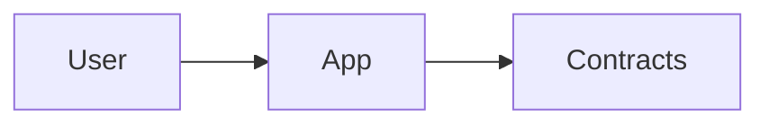

<!-- Starter README. Fill every <placeholder>, delete every comment, delete sections that truly do not apply. Order matters: a judge reads top to bottom and stops early. Rules: AGENTS.md Sections 5, 6, 13 and 14. No hype words, no em or en dashes. -->

# <Product name>

**<One line: what it does for whom, under ten words.>**

<Two sentences: the problem with one real number we measured ourselves, then what the product does about it.>

> **Maturity, stated up front.**
> - Network: <testnet or mainnet, chain id>. Funds: <test or real>.
> - Real: <contracts, data feeds, integrations that actually run>.
> - Simulated or partial: <anything that is not the production path, said plainly>.
> - Limits: see [Security and limitations](#security-and-limitations).

## Demo

| | |
|---|---|
| Live app (how a judge gets in without a wallet) | <short production URL> |
| Pitch video (<length>) | <link> |
| Technical demo (<length>) | <link> |
| Judge tour, three minutes | [JUDGES.md](JUDGES.md) |
| Claims with file and line | [docs/claims.md](docs/claims.md) |
| Tracks and bounties entered | <track> · <bounty> · <bounty> |

**Team:** <names, one line each>. **AI tools:** <disclose as the rules require>.

## The problem

<Who has it, how they cope today, why existing options fail. One measured fact or user quote.>

## What it does

<Three or four sentences, or one short formula if the product is a rule.>

## Claims you can check

<!-- Every row must be falsifiable: a transaction link, a command, or a file and line. No row without proof. -->

| Claim | Check it |
|---|---|
| <claim> | <explorer link, or `command`> |

## Traction

<!-- Counted facts only. Label our own transactions as ours. -->

- <users, trades, volume, integrations by other teams>
- Our own test activity: <count>, labelled as ours.

**Next 30 days:** <three concrete steps>.

## Remove a sponsor and <Product> stops

| Remove | What breaks |
|---|---|
| <Sponsor tool> | <the function that no longer works> |
| <Chain> | <why the design needs this chain: one mechanism> |

## How it fits each sponsor

### <Sponsor>: <bounty name>

| Requirement (verbatim) | How we meet it | Proof |
|---|---|---|
| <requirement> | <what we built> | <tx, link or clip> |

## Deployed contracts

Full list with deploy and demo transactions: [deployments.md](deployments.md).

| Contract | Address | Verified |
|---|---|---|
| <name> | <explorer link> | <yes or no> |

## Architecture



Key decisions and their tradeoffs: [docs/decisions/](docs/decisions/).

## Verification

| Suite | Result (<date>) |
|---|---|
| <contracts: unit, fuzz, invariant> | <n passed> |
| <app> | <n passed> |

One command runs everything: `<command>`. Not tested: <say what>.

## Run it yourself

```
<clone, install, env from .env.example, test, start>
```

## Security and limitations

Full list: [docs/limits.md](docs/limits.md).

- Not audited. <What was reviewed and how.>
- <The largest trust assumption, named plainly.>
- <What is roadmap and not built.>

## Built during the event, and what existed before

- **Built in the window (<dates>):** <list>.
- **Pre-existing:** <list, or "nothing">.

## Licence

<licence>
