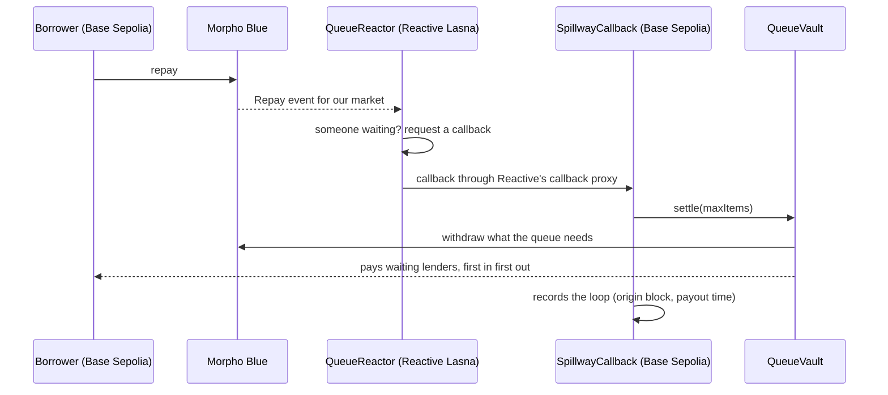

# Spillway

**Sell your place in a withdrawal queue for cash now.**

When a lending vault is fully lent out, withdrawals wait, and returning cash goes to whoever is fastest. Spillway's queue pays waiting lenders in order the moment a borrower repays (a median 1.6 s later, over 204 live loops), and its pool buys queue places from lenders who would rather leave now.

> **Maturity, stated up front.**
> - Network: Base Sepolia (84532) and Reactive Lasna (5318007). Test funds only. Unaudited.
> - Real: the vault lends on the deployed Morpho Blue contract, the reactive contract runs on Reactive Network, and every payout shown in the app is a transaction on chain.
> - Ours: the Morpho market (USDC against a demo collateral token with a fixed-price oracle), the demo account, and every transaction so far. None of it is user traffic.
> - Limits: see [Limits](#limits).

## Demo

| | |
|---|---|
| Live app, no wallet needed | https://spillway-phi.vercel.app/demo |
| Measured latency and the race experiment | https://spillway-phi.vercel.app/latency |
| Contract addresses, transactions and verified source | [deployments.md](deployments.md) |
| How every number was measured | [measurements/README.md](measurements/README.md) |
| Track | Reactive Omni Buildathon, Every Second Counts |

On the demo page, press **Queue a 2 USDC withdrawal**, then **Repay 2 USDC**, then open the request. It shows the repayment on Base Sepolia, the reactive transaction on Lasna and the payout on Base Sepolia, each linked to its explorer, and how many milliseconds the loop took.

## The problem

Curated lending vaults lend out most of what they hold. When borrowing is heavy, utilization reaches 100 percent and withdrawals cannot be paid. On 4 November 2025, after the Stream Finance collapse, Gauntlet reported withdrawable liquidity in two of its Morpho vaults below 1 percent for about six hours. When cash does come back, the lender with the fastest bot gets it; everyone else keeps refreshing.

## What it does

- **A queue that settles itself.** A withdrawal the vault cannot pay joins a first in, first out queue. A reactive contract on Reactive Network watches the Morpho market for repayments, new deposits and liquidations. When cash arrives and someone is waiting, it calls the vault on Base Sepolia, and the vault pays the queue from the front. No keeper, no cron job, no claim button.
- **Cash now, for a fee you see first.** The pool buys a place in the queue and pays the lender at once, minus a fee of 0.08 to 3 percent that rises as the pool's cash runs down. When the vault later pays that place, the pool gets the full amount. The fee is the pool's income.

## Measured results

From [measurements/README.md](measurements/README.md), all on chain:

| | |
|---|---|
| Repayment to payout, 204 loops | median 1.6 s, p90 2.4 s, p99 4.0 s, 1.0 s to 6.6 s |
| Loops paid within 2 s | 173 of 204 |
| Competitor landing within 1.4 s of a repayment | won the cash 16 of 16 times |
| Competitor landing 1.6 to 2.6 s after | queue won 12 of 14 |
| Competitor landing 3.2 s or later | queue won 10 of 10 |

**Why this needs Reactive Omni.** Cash that a borrower repays is contested. A bot on the same chain that acts within about a second will always get it first, and Spillway does not claim otherwise. Anyone slower, such as a person, a keeper polling on a schedule, or a bot that waits a few blocks, now loses it to the queue. On the previous Reactive Network, with blocks about 7 s apart, the loop alone took longer than that (an estimate from block times, not measured).

## How it works



| Contract | Chain | Job |
|---|---|---|
| [`QueueVault`](contracts/src/QueueVault.sol) | Base Sepolia | ERC-4626 deposits lent on one Morpho Blue market. `requestRedeem` pays at once or queues. `settle` pays the queue in order and is open to anyone. Keeps every request in storage. |
| [`InstantPool`](contracts/src/InstantPool.sol) | Base Sepolia | Buys queue places: `cashOut` in one step, or `buyClaim` for a place already held. Fee rises as its cash drains. |
| [`QueueReactor`](contracts/src/QueueReactor.sol) | Reactive Lasna | Subscribes to Morpho `Repay`, `Supply` and `Liquidate` for this market and to the vault's queue events. Requests a callback only when someone is waiting, and again while more can be paid. |
| [`SpillwayCallback`](contracts/src/SpillwayCallback.sol) | Base Sepolia | Accepts calls only from Reactive's callback proxy acting for our reactor, settles the queue, records each loop with a millisecond timestamp. |

Decisions worth knowing:
- **History lives in contract storage.** The app reads requests, sales and loops with view calls, so it needs no indexer.
- **Latency is timed on chain.** Start: the repayment block's millisecond timestamp. End: the time `SpillwayCallback` stored, read from Base's `BaseTime` predeploy, because `block.timestamp` is whole seconds while Base Sepolia makes a block every 200 ms.
- **Strict order, no partial payments.** A request too large for the cash that came back waits for more, and nobody behind it skips ahead. That is the fairness promise, and it is also why the pool exists.

## Tests

59 Foundry tests in [`contracts/test`](contracts/test): unit tests, fuzz tests (256 runs), six invariants (64 runs of 80 random calls each, no reverts), a simulated reactive loop including the callback proxy's sender check, and five fork tests against the Morpho Blue contract on Base Sepolia.

```bash
cd contracts && ./install-deps.sh
BASE_SEPOLIA_RPC=https://sepolia.base.org forge test
```

## Run it yourself

```bash
cd web && pnpm install
cp .env.example .env.local      # set NEXT_PUBLIC_CHAIN_ADAPTER=real
node scripts/create-demo-wallet.mjs   # optional: a throwaway testnet account for the demo console
pnpm dev
```

Deploying your own copy of the contracts: the four commands at the end of [deployments.md](deployments.md).

## Limits

The full security review and every known limit are in [docs/limits.md](docs/limits.md). The ones that matter most:

- Unaudited, testnet only. Do not send real funds.
- A bot on the same chain that acts within about a second beats the queue to returning cash.
- Strict first in, first out: one large request at the front blocks smaller ones behind it until enough is repaid.
- The pool's fee depends on how drained the pool is, not on how long a place will wait.
- The demo market is ours: anyone can mint its collateral, so its cash can be borrowed and not repaid. Every demo loop brings its own cash, so the loop keeps working.
- Anyone can make the reactor spend gas by touching the market; it stops if its lREACT runs out until it is topped up.

## License

MIT. See [LICENSE](LICENSE).
