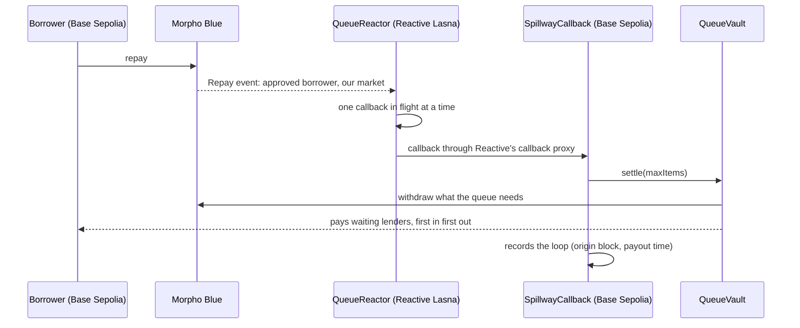

# Spillway

[](https://github.com/whatsgood200/spillway/actions/workflows/ci.yml)

**Sell your place in a withdrawal queue for cash now.**

Judges: the three-minute tour is [JUDGES.md](JUDGES.md), and every claim with the line that enforces it is in [docs/claims.md](docs/claims.md).

When a lending vault is fully lent out, withdrawals wait, and returning cash goes to whoever is fastest. Spillway's queue pays waiting lenders in order the moment a borrower repays (a median 1.4 s later on the current contracts, 1.6 s over 204 earlier loops), and its pool buys queue places from lenders who would rather leave now.

> **Maturity, stated up front.**
> - Network: Base Sepolia (84532) and Reactive Lasna (5318007). Test funds only, not audited by a third party.
> - Real: the vault lends on the deployed Morpho Blue contract, the reactive contract runs on Reactive Network, and every payout shown in the app is a transaction on chain.
> - Ours: the Morpho market (USDC against a collateral token only approved borrowers can hold, with a fixed-price oracle), the demo account, and every transaction so far. None of it is user traffic.
> - Security: every finding of a written abuse review is fixed and covered by a test that performs the attack. See [docs/threat-model.md](docs/threat-model.md).

## Demo

| | |
|---|---|
| Live app, no wallet needed | https://spillway-phi.vercel.app/demo |
| Three-minute tour for judges | [JUDGES.md](JUDGES.md) |
| Every claim, with its line of code, test or transaction | [docs/claims.md](docs/claims.md) |
| Measured latency and the race experiment | https://spillway-phi.vercel.app/latency |
| Contract addresses, transactions and verified source | [deployments.md](deployments.md) |
| How every number was measured | [measurements/README.md](measurements/README.md) |
| Threat model: every way in, and how it is closed | [docs/threat-model.md](docs/threat-model.md) |
| Track | Reactive Omni Buildathon, Every Second Counts |

On the demo page, press **Queue a 2 USDC withdrawal**, then **Repay 2 USDC**, then open the request. It shows the repayment on Base Sepolia, the reactive transaction on Lasna and the payout on Base Sepolia, each linked to its explorer, and how many milliseconds the loop took.

## The problem

Curated lending vaults lend out most of what they hold. When borrowing is heavy, utilization reaches 100 percent and withdrawals cannot be paid. On 4 November 2025, after the Stream Finance collapse, Gauntlet reported withdrawable liquidity in two of its Morpho vaults below 1 percent for about six hours. When cash does come back, the lender with the fastest bot gets it; everyone else keeps refreshing.

## What it does

- **A queue that settles itself.** A withdrawal the vault cannot pay joins a first in, first out queue. When a borrower repays the Morpho market, a reactive contract on Reactive Network calls the vault on Base Sepolia, and the vault pays the queue from the front. A new deposit pays the queue on its way in. No keeper, no cron job, no claim button.
- **Paid in order, in parts if needed.** If the cash that comes back does not cover the front request, it is paid in part, and nobody behind it is paid until it is complete. One large request cannot hold the line still.
- **Cash now, for a fee you see first.** The pool buys a place in the queue and pays the lender at once. The fee has two parts: one rises as the pool's cash runs down, the other with how much is queued ahead, and the total is capped at 5 percent. When the vault pays that place, the pool gets the full amount. The fee is the pool's income.

## Measured results

From [measurements/README.md](measurements/README.md), all on chain:

| | |
|---|---|
| Repayment to payout, current contracts (v3), 20 loops | median 1.4 s, p90 2.0 s, 1.0 s to 2.0 s, none failed |
| Repayment to payout, earlier contracts (v2), 204 loops | median 1.6 s, p90 2.4 s, p99 4.0 s, 1.0 s to 6.6 s |
| Competitor landing 1.6 to 2.6 s after a repayment (v2) | queue got the cash 12 of 14 times |
| Competitor landing 3.2 s or later (v2) | queue got the cash 10 of 10 times |

**Why this needs Reactive Omni.** Cash that a borrower repays is contested. A person, a keeper polling on a schedule, or a bot that waits a few blocks now loses it to the queue, because the loop closes in about 1.5 seconds. On the previous Reactive Network, with blocks about 7 s apart, the loop alone took longer than that (an estimate from block times, not measured).

## How it works



| Contract | Chain | Job |
|---|---|---|
| [`QueueVault`](contracts/src/QueueVault.sol) | Base Sepolia | ERC-4626 deposits lent on one Morpho Blue market. `requestRedeem` pays at once or queues. `settle` pays the queue strictly in order, the front request in parts if needed, and is open to anyone. Deposits pay the queue on the way in. Keeps every request in storage. |
| [`InstantPool`](contracts/src/InstantPool.sol) | Base Sepolia | Buys queue places: `cashOut` in one step, or `buyClaim` for a place already held. Fee by pool drain plus line length, capped at 5 percent. New deposits are locked for an hour. |
| [`QueueReactor`](contracts/src/QueueReactor.sol) | Reactive Lasna | Watches Morpho `Repay` only when an approved borrower repays its own loan, and `Liquidate` of an approved borrower. Keeps one callback in flight and remembers repayments that land meanwhile. The deployer can pause it. |
| [`SpillwayCallback`](contracts/src/SpillwayCallback.sol) | Base Sepolia | Accepts calls only from Reactive's callback proxy acting for our reactor, settles the queue, records each loop with a millisecond timestamp. |
| [`RestrictedCollateral`](contracts/src/RestrictedCollateral.sol) | Base Sepolia | The demo market's collateral. Only approved accounts can mint or hold it, so only approved borrowers can borrow. |

Decisions worth knowing:
- **Nothing a stranger does can make us pay.** The reactor's subscriptions match only our approved borrowers' own repayments, so no supply, deposit or 1 wei repayment by anyone else reaches it. Deposits pay the queue inside the vault, without the reactor.
- **History lives in contract storage.** The app reads requests, sales and loops with view calls, so it needs no indexer.
- **Latency is timed on chain.** Start: the repayment block's millisecond timestamp. End: the time `SpillwayCallback` stored, read from Base's `BaseTime` predeploy, because `block.timestamp` is whole seconds while Base Sepolia makes a block every 200 ms.

## Security

A written abuse review lists every actor and every entry point, and asks for each what it costs the caller, what it costs us and what they could gain. All findings are fixed in the current contracts, each with a test that performs the attack and shows it fails: [docs/threat-model.md](docs/threat-model.md). A summary of what was checked: [docs/limits.md](docs/limits.md).

## Tests

77 Foundry tests in [`contracts/test`](contracts/test): unit tests, fuzz tests (256 runs), six invariants (64 runs of 80 random calls each, no reverts), attack tests for every threat-model finding, a simulated reactive loop including the callback proxy's sender check, and fork tests against the Morpho Blue contract on Base Sepolia. Line coverage of the contracts: 87 to 97 percent. The suite, a type-check, lint, production build and dependency audit of the web app run on every push ([CI](.github/workflows/ci.yml)).

```bash
cd contracts && ./install-deps.sh
BASE_SEPOLIA_RPC=https://sepolia.base.org forge test
```

## Run it yourself

```bash
cd web && pnpm install
cp .env.example .env.local      # set NEXT_PUBLIC_CHAIN_ADAPTER=real
node scripts/create-demo-wallet.mjs   # optional: a throwaway testnet account for the demo console
pnpm dev
```

Deploying your own copy of the contracts: the four commands at the end of [deployments.md](deployments.md).

## Scope

Base Sepolia and Reactive Lasna testnets, test funds only, not audited by a third party.

## License

MIT. See [LICENSE](LICENSE).
